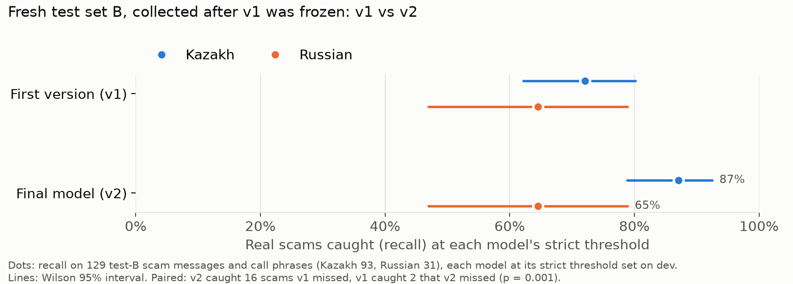
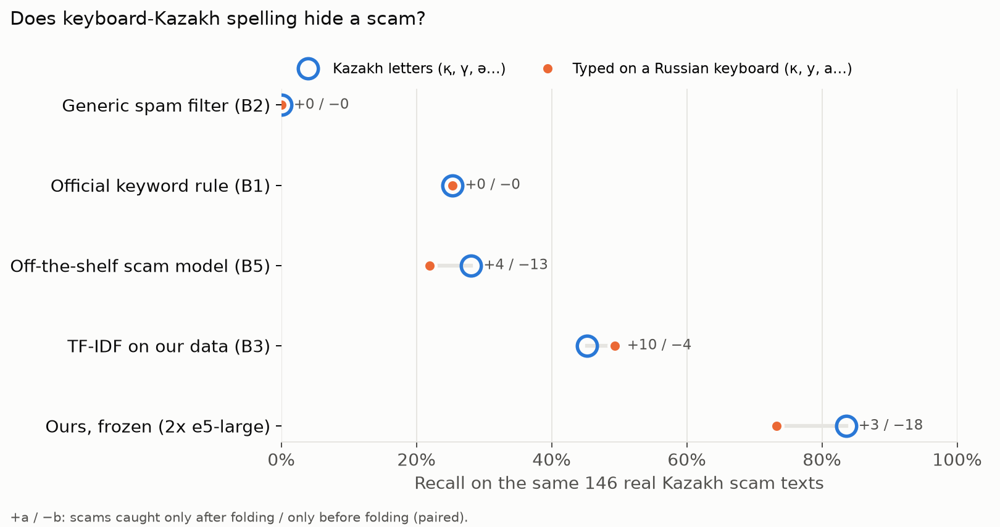

# Сақ бол: catching phone and message scams in Kazakh, Russian and the mix people actually type

**Track:** Finance · **Team:** TBD · *This project is a prototype and is not financial advice.*

**On unseen real Kazakhstan scam texts (test B), the final model catches 82% (Kazakh 87%, Russian 65%; 76% averaged over the two languages) and flagged 1 of 1,978 held-out everyday messages. Our first version caught 71% of the same texts.**

## The problem

Gulnara apa is 67, lives in Astana and speaks Kazakh first. A call comes in: "Kaspi security. Someone is taking a loan in your name. Read me the code so we can cancel it." Kazakhstan registered 27,892 internet-fraud cases in 2025, a record (Committee on Legal Statistics, via bizmedia.kz, 2026-10-12). Since 1 October 2026 lenders must ask seven anti-fraud questions before an unsecured online loan, and two of them describe calls like this (ARDFM resolution of 15 May 2026, via finratings.kz, 2026-09-29). Scam filters work in English and Russian. We found no public labelled scam data in Kazakh, and people here mix the two languages and type Kazakh on Russian keyboards.

## What we built

Paste a message, or a call transcript with one line per turn. The model returns a risk band (scam, suspicious, no clear signs), highlights the phrase that drove the score, lists red flags from the official keyword list, and gives one action in Kazakh or Russian ("Қоңырауды үзіңіз. Банкке картаның артындағы не ресми қосымшадағы нөмір арқылы өзіңіз хабарласыңыз."). Call mode re-scores after each turn; it is a demo only, since we had no real call transcripts to test on. Run: `python app.py`, or the last cell of `notebooks/saq_bol.ipynb`.

## What we added

Our own idea.
- **Real evaluation data.** 995 texts copied word for word from 516 public pages of Kazakhstan banks, regulators, police, eGov and news, each with URL and date and checked by script against the page.
- **A fairness check without personal data.** Language is the group: we compare the same official text in Kazakh and Russian, and the same Kazakh scam typed with and without Kazakh letters.
- **A false-alarm rule users would feel.** The threshold must flag at most 1 in 100 everyday chat messages and at most 1 in 20 real service SMS on dev. We added the second rule after catching our model flagging real OTP messages.
- **Honest iteration.** Version 1 was frozen and scored once on test set A. For version 2 we moved test A into training and collected test set B from 127 new pages before scoring either model on it. Deviations from our written plan, all disclosed in SPEC.md: we trained four seeds instead of the three we named (all launched together, before any result); test B's text-overlap check ran against dev but not training (5 items exceed it; without them: 82% vs 71%, Russian 63%); the everyday-chat set is the same one used for test A.

## How it works

Data: about 81,000 training rows, since no labelled Kazakh scams exist. Open scam corpora from Hugging Face, about 2,600 Kazakh machine translations (NLLB-200), 4,850 synthetic Kazakhstan-specific messages and call phrases written by Claude under a fixed protocol, 294 real Russian scams from non-Kazakhstan sources, 27,000 real chat lines and rule-based bank notifications as negatives, and (v2 only) the 500 spent test-A texts. Near-copies of any evaluation text were dropped.

Model: four `multilingual-e5-large` fine-tunes (Kaggle T4, different seeds); their standardized (z-scored) logits are averaged. We also tried XLM-R large, a Kazakh RoBERTa and an existing scam detector. Every choice was made on a fixed development set (225 texts) by rules written down in advance (SPEC.md); each test set was scored once per frozen model (RUNS.md).

## Results

**Test B** (195 texts from 127 pages never used before; 129 scam messages and call phrases: 93 Kazakh, 31 Russian, 5 mixed; 28 of them date from 2020-22):

| Model | Scams caught | Kazakh (93) | Russian (31) | Everyday chat flagged | Real bank/eGov notices flagged (39) |
|---|---|---|---|---|---|
| Version 1 | 71% [63, 78] | 72% | 65% | 0.30% | 18% (7) |
| **Version 2 (final)** | **82% [75, 88]** | **87% [79, 92]** | **65% [47, 79]** | **0.05%** | **8% (3)** |

On the same 129 scams, v2 caught 16 that v1 missed and v1 caught 2 that v2 missed (McNemar p = 0.001). The 5 mixed-language scams were all caught. On scams one blind AI annotator tagged recognizable or maybe recognizable from the text alone, v2 catches 88% (Kazakh 90%). On scams published in 2026 it catches 76% (32 of 42).

**Test A** (version 1 only, 254 scams), same rule for every model, Wilson 95% intervals:

| Model | Scams caught | Kazakh | Russian | Service SMS flagged |
|---|---|---|---|---|
| Generic spam filter | 4.7% | 0% | 11% | 7% |
| Official keyword rule* | 27% | 25% | 30% | 14.5% |
| Existing multilingual scam model | 30% | 28% | 33% | 10% |
| TF-IDF on our data | 44% | 45% | 42% | 16% |
| Version 1 | 81% [75, 85] | 84% | 77% | 14.5% |

\*At its own setting (any red flag).

We aimed for 90% in both languages. We reached it only on recognizable Kazakh scams.

## Where it fails

- **Russian stayed at 65%** on test B, and 22 of its 31 scams come from one outlet (Finratings.kz). Of the 11 misses, 3 are fake pension-fund recalculation offers ("У вас доплата от ЕНПФ за прошлые годы") and most of the rest need the call around them ("не звони, не могу говорить", "Ваш заказ уже на складе").
- **Service messages.** Version 1 flagged 14.5% of real service SMS on test A, against a 5% target. Version 2 trained on those SMS; public sources gave only 2 new SMS, so we measured it on 39 real bank and eGov notices instead (8% flagged). Two of its 3 false alarms are the bank's own anti-fraud question, "Операцияны өзіңіз жүргізіп жатырсыз ба?".
- **Keyboard Kazakh still costs about 11 points** (87% to 76% on the same test-B scams, p = 0.03).
- **English junk text** (code, gibberish) caused most chat false alarms for v1.

## What we'd do next

1. Measure and calibrate SMS false alarms on a few hundred real notifications from volunteers' phones, with consent.
2. Collect real keyboard-Kazakh and Russian call-transcript scams.
3. Add speech-to-text for live calls, and distil the four models into one that fits a phone.

## Sources

Every dataset, model, tool and AI assistant, with links and licences: [CREDITS.md](CREDITS.md). Claude Code (Anthropic) was used for research, coding, synthetic data and design reviews.
