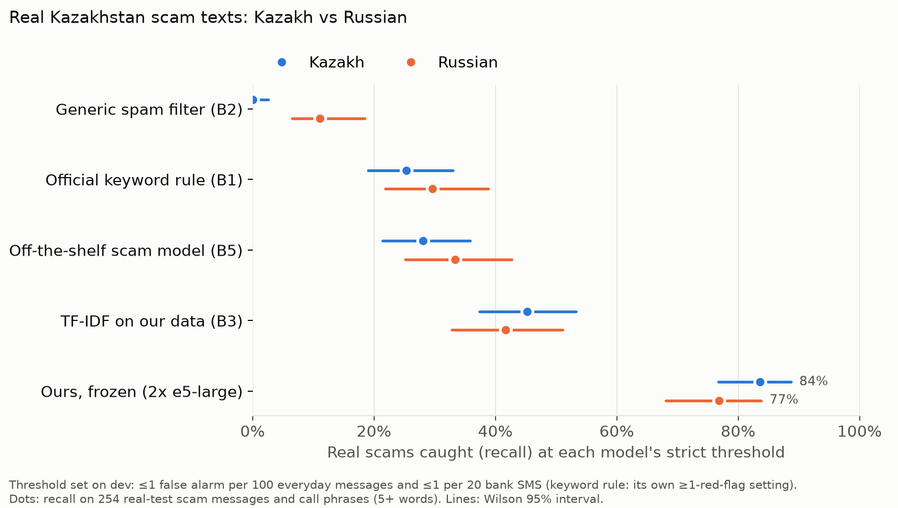

# Сақ бол: catching phone and message scams in Kazakh, Russian and the mix people actually type

**Track:** Finance · **Team:** TBD · *This project is a prototype and is not financial advice.*

**On 254 real Kazakhstan scam texts it never saw, the model catches 81%. The best baseline catches 44%. It raises 3 false alarms per 1,000 everyday messages, but 14.5% on real service SMS.**

## The problem

Gulnara apa is 67, lives in Astana and speaks Kazakh first. A call comes in: "Kaspi security. Someone is taking a loan in your name. Read me the code so we can cancel it." Kazakhstan registered 27,892 internet-fraud cases in 2025, a record (Committee on Legal Statistics, via bizmedia.kz, 2026-10-12). Since 1 October 2026 lenders must ask seven anti-fraud questions before an unsecured online loan, and two of them describe calls like this (ARDFM resolution of 15 May 2026, via finratings.kz, 2026-09-29). Scam filters work in English and Russian. We found no public labelled scam data in Kazakh, and people here mix the two languages and type Kazakh on Russian keyboards.

## What we built

Paste a message, or a call transcript with one line per turn. The model returns a risk band (scam, suspicious, no clear signs), highlights the phrase that drove the score, lists red flags from the official keyword list, and gives one action in Kazakh or Russian ("Қоңырауды үзіңіз. Банкке картаның артындағы нөмір арқылы өзіңіз хабарласыңыз."). Call mode re-scores after each turn. It is a demo only: we had no real call transcripts to test it on. Run: `python app.py runs/ens_v6c_e5s2s3_logit_z`, or the last cell of `notebooks/saq_bol.ipynb`.

## What we added

Our own idea.
- **A real evaluation set.** 800 texts copied word for word from 389 public pages of Kazakhstan banks, regulators, police, eGov and news, each with URL and date and checked by script against the page. 225 are for development, 575 for the final test. Neither is trained on.
- **A fairness check without personal data.** Language is the group. We compare the same official text in Kazakh and Russian, and the same Kazakh scam typed with and without Kazakh letters.
- **A false-alarm rule users would feel.** The threshold must flag at most 1 in 100 everyday chat messages and at most 1 in 20 real service SMS on dev. We added the second rule after catching our model flagging real OTP messages.

## How it works

Data: 78,000 training rows, with no labelled Kazakh scams available. They include open scam corpora from Hugging Face, about 2,600 Kazakh machine translations (NLLB-200), 4,850 synthetic Kazakhstan-specific messages and call phrases written by Claude under a fixed protocol, 294 real Russian scams from non-Kazakhstan sources, 27,000 real chat lines, and rule-based bank notifications as negatives. We dropped 155 rows that were near-copies of evaluation items.

Model: two `multilingual-e5-large` fine-tunes (Kaggle T4, seeds 2 and 3, the two best of 40 dev configurations), with scores averaged. We also tried XLM-R large, a Kazakh RoBERTa and an existing scam detector.

Testing: every choice was made on dev. Test was scored once, after freezing (RUNS.md). Of the predictions in SPEC.md, two were falsified, one half falsified, one inconclusive and one supported.

## Results

Real-test, same threshold rule for every trained model, Wilson 95% intervals (grouping by source page widens our headline to [73, 86]):

| Model | Scams caught | Kazakh | Russian | Service SMS flagged | Chat flagged |
|---|---|---|---|---|---|
| Generic spam filter | 4.7% | 0% | 11% | 7% | 0.3% |
| Official keyword rule* | 27% | 25% | 30% | 14.5% | 0.2% |
| Existing multilingual scam model | 30% | 28% | 33% | 10% | 0.1% |
| TF-IDF on our data | 44% | 45% | 42% | 16% | 0.2% |
| **Ours** | **81% [75, 85]** | **84% [77, 89]** | **77% [68, 84]** | **14.5% [8, 25]** | **0.3%** |

\*At its own setting (any red flag). Of 219 flagged test texts, 205 were scams (94%, at the test set's artificial mix).

We aimed for 90% in both languages and did not reach it. A blind annotator (an AI agent without model outputs) tagged test scams as recognizable from the text alone, maybe, or not; a second annotator re-tagged 80 (κ = 0.73). On the 216 recognizable-or-maybe scams the model catches 89% (Kazakh 90%, Russian 88.5%). It catches 69% of scam types never seen in training.

## Where it fails

- **Lines that need the call around them**, such as "Не надо сбрасывать" or "У вас осталось две минуты": only 32% caught. Russian has more of these (19% of test scams vs 12% in Kazakh), which is why Russian trails overall.
- **Real service SMS with scam words**, like a bank's own warning "Вам сообщили о попытке оформления кредита? Срочно созвонитесь с банком!" or a courier code. We hit our 5% target on dev but got 14.5% on test. The threshold rests on 45 dev messages, and we wrote our notification templates after seeing dev errors. 43 of the 69 test SMS come from a GitHub collection of bank formats.
- **Keyboard Kazakh costs 10 points** (84% to 73% on the same scams). The same official text is caught more often in Russian: of 45 test pairs, 10 were caught only in Russian and 1 only in Kazakh.
- **English junk text** (code, gibberish) causes 5 of the 6 chat false alarms.

## What we'd do next

1. Calibrate the SMS threshold on a few hundred real notifications from volunteers' phones, with consent.
2. Collect real keyboard-Kazakh scams; we found none in public sources.
3. Add speech-to-text so call mode works on live calls, and distil the model to fit a phone.

## Sources

Every dataset, model, tool and AI assistant, with links and licences: [CREDITS.md](CREDITS.md). Claude Code (Anthropic) was used for research, coding, synthetic data and design reviews.
