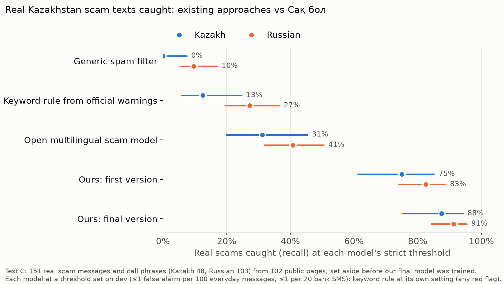

# Сақ бол: catching phone and message scams in Kazakh, Russian and the mix people actually type

**Track:** Finance · **Team:** tryHard · *This project is a prototype and is not financial advice.*

**Existing approaches catch 7% to 38% of real Kazakhstan scam texts, and at most 31% of the Kazakh ones: a generic spam filter, a keyword rule built from official red-flag warnings, and an open multilingual scam model. Сақ бол catches 90%: Russian 91%, Kazakh 88%. We measured all of them on the same 151 real scam texts, set aside before our final model was trained. Сақ бол flags 5 of 1,978 everyday chat messages (0.25%).**

## The problem

Gulnara apa is 67, lives in Astana and speaks Kazakh first. A call comes in: "Kaspi security. Someone is taking a loan in your name. Read me the code so we can cancel it." Kazakhstan registered 27,892 internet-fraud cases in 2025, a record (Committee on Legal Statistics, via bizmedia.kz, 2026-10-12). Since 1 October 2026 lenders must ask seven anti-fraud questions before an unsecured online loan, and two of them describe calls like this (ARDFM resolution of 15 May 2026, via finratings.kz, 2026-09-29). We found no public labelled scam data in Kazakh, and people here mix the two languages and type Kazakh on Russian keyboards.

## Existing approaches

We scored two simple tools built from public material and one open model on the same real texts as our model:
- **A keyword rule we wrote from official red-flag warnings** (the scheme types banks and the regulator warn about: SMS-code requests, "security service", "safe account" and so on) catches 23% of scams and 13% of Kazakh ones. It also flags 3 of 4 real Kazakhstan service SMS, because they say things like "Никому не сообщайте свой код" and "Сообщите код курьеру после получения товара".
- **A generic spam filter** (our TF-IDF model trained on English SMS spam and a Russian spam corpus, mostly machine-translated email) catches 7%, and none of the Kazakh scams.
- **An open multilingual scam detector** (Horizon-Labs/phishing-scam-detector-base, used as is) catches 38%, 31% of Kazakh ones. With Kazakh letters swapped for Russian ones, as when typing on a Russian keyboard, it loses 5 of its 15 Kazakh catches.

## What we built

Paste a message, or a call transcript with one line per turn. The model returns a risk band (scam, suspicious, no clear signs), highlights the phrase that drove the score, lists red flags from our keyword rule (built from official warnings), and gives one action in Kazakh or Russian ("Қоңырауды үзіңіз. Банкке картаның артындағы не ресми қосымшадағы нөмір арқылы өзіңіз хабарласыңыз."). Call mode re-scores after each turn; it is a demo only, since we had no real call transcripts to test on.

Model: https://huggingface.co/itsaibarr/saq-bol-v3 (1.1 GB). Run: `huggingface-cli download itsaibarr/saq-bol-v3 --local-dir runs/kg_e5L_v8b_s1/best`, then `python app.py`. The notebook shows every result without the model, and on Colab it opens the demo. On a Mac the demo made the same decision as the evaluated model on all 306 test-C texts and 100 everyday chat lines we checked.

## Results

**Test C:** 306 real texts copied word for word from 204 public pages never used before, locked before our final model's training data was built. Every model is scored once, at a threshold set on the development set with the same rule: at most 1 false alarm per 100 everyday messages and 1 per 20 real service SMS. The keyword rule is shown at its own setting (any red flag), because under that rule it catches 1%.

| Model | Scams caught (151) | Russian (103) | Kazakh (48) | Russian, outside Kazakhstan (76) | Everyday chat flagged (1,978) | Official and bank texts flagged (46) |
|---|---|---|---|---|---|---|
| Generic spam filter | 7% | 10% | 0% | 9% | 0.25% | 11% |
| Keyword rule from official warnings | 23% | 27% | 13% | 17% | 0.15% | 7% |
| Open multilingual scam model | 38% | 41% | 31% | 36% | 0.05% | 4% |
| Ours, first version | 80% | 83% | 75% | 80% | 0.30% | 9% |
| Ours, second version | 80% | 83% | 73% | 75% | 0.05% | 4% |
| **Ours, final version** | **90% [84, 94]** | **91% [84, 95]** | **88% [75, 94]** | **88% [79, 94]** | **0.25%** | **7%** |

Brackets: Wilson 95% intervals. On the same 151 scams, the final version caught 80 that the best existing tool missed, and that tool caught 1 the final version missed (McNemar p < 0.001). Against our own first version: 17 vs 2 (p = 0.0007). On scams a blind AI annotator tagged recognizable or maybe recognizable from the text alone, the final version catches 95% (Russian 98%, Kazakh 90%). The Russian set from outside Kazakhstan (Russia, Belarus, Kyrgyzstan, Uzbekistan, Moldova) comes from publishers never used in training.

We aimed for 90% in both languages. Russian's point estimate reached it (91%); Kazakh's did not (88%, 48 texts). Neither interval rules out a true rate below 90%. The 90% overall clears the line by one text (136 of 151).

Two test-C items are questionable. One Kazakh "scam" is ordinary bank-warning wording (without it: 90.0%, Kazakh 87%). One Russian item from outside Kazakhstan nearly appears inside a longer training quote (without it, that column is 88.0%, 66 of 75; the 151-text total does not include it). The existing tools and our first version were added to test C at our request after the final version was scored; no model changed (SPEC.md A8).

With Kazakh letters swapped for Russian ones (simulated keyboard typing), the same 48 Kazakh scams cost the open scam model 5 of its 15 catches and our final version 2 of its 42. The keyword rule applies the same letter map itself, so this test cannot change its 6 catches.

## What we added

Our own idea.
- **Real evaluation data.** 1,301 texts copied word for word from 720 public pages of Kazakhstan banks, regulators, police, eGov, official Telegram channels and news (plus a Russian set from outside Kazakhstan), each with URL and date and checked by script against the page.
- **A fairness check without personal data.** Language is the group: Kazakh vs Russian on the same test set, and the same Kazakh scam typed with and without Kazakh letters.
- **A false-alarm rule users would feel.** The threshold must flag at most 1 in 100 everyday chat messages and at most 1 in 20 real service SMS on dev. We added the second rule after catching our model flagging real OTP messages.
- **Three versions, three fresh test sets.** Each version was frozen, then scored once on a test set collected before it was scored. That test set then moved into training and we collected a new one: A for version 1 (81%), B for version 2 (82%), C for version 3 (90%). These three numbers come from different texts and are not comparable; the table above compares all versions on test C. The rules for each round were written down before its data or training (SPEC.md A6, A7); deviations are listed there.

## How it works

Data: about 84,000 training rows, since no labelled Kazakh scams exist. Open scam corpora from Hugging Face, about 2,600 Kazakh machine translations (NLLB-200), 6,050 synthetic Kazakhstan-specific messages and call phrases written by Claude under fixed protocols, 989 real Russian scam quotes from non-Kazakhstan sources, 27,000 real chat lines and rule-based bank notifications as negatives, and the spent test-A and test-B texts. Near-copies of any evaluation text were dropped.

The final version targets Russian. Version 2 caught 87% of Kazakh scams on test B but 65% of Russian ones, and its training had 10 Russian legit rows for every Russian scam (Kazakh: 2 to 1). Version 3 adds 651 real Russian scam quotes and 1,200 Russian-heavy synthetic rows (pension "recalculation" offers, delivery pretexts, relatives in trouble, "don't trust the bank staff" instructions), and counts Russian scams twice in training. Kazakh gained even more than Russian over version 2 on test C (+15 vs +8 points), so much of the gain likely comes from test B's 93 Kazakh scams joining training.

Model: one `multilingual-e5-large` fine-tune (Kaggle T4, 2 epochs). Version 2 averaged four; for version 3 our pre-written selection rule (when dev scores are within 0.005, fewer models wins) chose a single model, four times cheaper to run. We also tried XLM-R large and a Kazakh RoBERTa. Model selection and thresholds used only a fixed development set (225 texts); version 3's added data was designed from version 2's test-B misses. Each test set was scored once per frozen model (RUNS.md).

## Where it fails

- **Call openers with no scam signal.** The final version misses lines like "На сколько лет вы хотите продлить?" and "Мы меняем ключи от домофона, вам два ключа?"; they only become scams later in the call. Versions 2 and 3 both flag some neutral delivery lines that real couriers also send ("На ваше имя пришла посылка. Будете получать?"), and version 3 adds more ("курьер не смог доставить заказ"). 7 of version 3's 16 extra catches over version 2 are lines a blind annotator could not recognise as scams from the text alone, so part of the gain comes from flagging more readily. Test C has no legit call lines, so false alarms on real couriers asking for an SMS code are not measured.
- **Service SMS false alarms are still not measured on fresh data.** Test C has only 10 real SMS: 0 of 4 Kazakhstan SMS flagged (one is a courier-code SMS, "Сообщите код курьеру после получения товара"), 2 of 6 from outside flagged ("Назовите сотруднику этот код, чтобы получить наличные в кассе" and the parcel-code SMS "12345 Сообщите код оператору для получения одного отправления"; version 2 flagged both too). Version 1 flagged 14.5% of real service SMS on test A.
- **More chat false alarms than version 2:** 5 of 1,978 vs 1 (inside the 1% limit; p = 0.125; the same chat lines as tests A and B). One of the 5 may be a real scam: an offer to rent out an account for 5,000 tenge.
- **Keyboard Kazakh is a best case.** The folded test texts use the same letter map we used on 8,471 training rows; real typing varies (і as и, ы or Latin i; ә as а or э; mixed words), and test C has no real keyboard-typed or mixed Kazakh-Russian scams.

## What we'd do next

1. Measure and calibrate SMS false alarms on a few hundred real notifications from volunteers' phones, with consent, especially delivery and bank-code SMS.
2. Collect real keyboard-Kazakh and Russian call-transcript scams.
3. Add speech-to-text for live calls, and shrink the model to fit a phone.

## Sources

Every dataset, model, tool and AI assistant, with links and licences: [CREDITS.md](CREDITS.md). Claude Code (Anthropic) was used for research, coding, synthetic data and design reviews.
