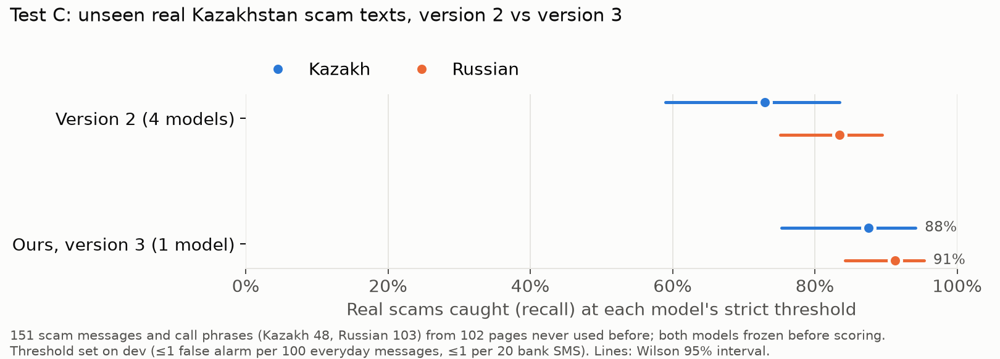
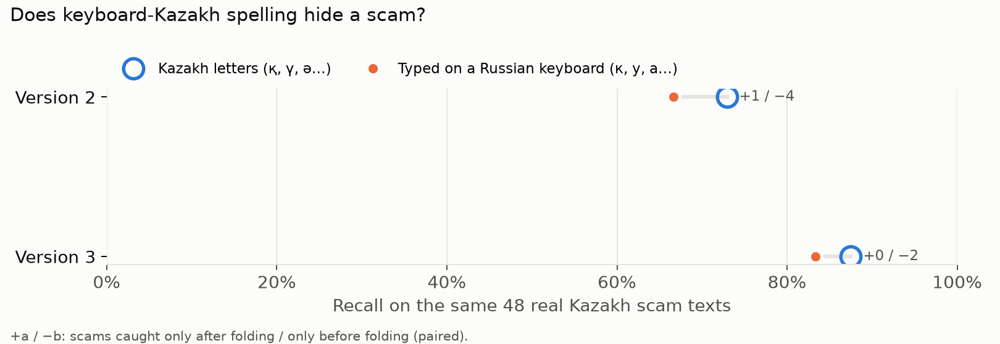

# Сақ бол: catching phone and message scams in Kazakh, Russian and the mix people actually type

**Track:** Finance · **Team:** TBD · *This project is a prototype and is not financial advice.*

**On 151 real Kazakhstan scam texts set aside before this model was trained (test C), the final model catches 90% (136; one fewer would be 89%): Russian 91% [84, 95] of 103, Kazakh 88% [75, 94] of 48. It flagged 5 of 1,978 held-out everyday chat messages (0.25%). The previous version caught 80% of the same texts (Russian 84%, Kazakh 73%).**

## The problem

Gulnara apa is 67, lives in Astana and speaks Kazakh first. A call comes in: "Kaspi security. Someone is taking a loan in your name. Read me the code so we can cancel it." Kazakhstan registered 27,892 internet-fraud cases in 2025, a record (Committee on Legal Statistics, via bizmedia.kz, 2026-10-12). Since 1 October 2026 lenders must ask seven anti-fraud questions before an unsecured online loan, and two of them describe calls like this (ARDFM resolution of 15 May 2026, via finratings.kz, 2026-09-29). Scam filters work in English and Russian. We found no public labelled scam data in Kazakh, and people here mix the two languages and type Kazakh on Russian keyboards.

## What we built

Paste a message, or a call transcript with one line per turn. The model returns a risk band (scam, suspicious, no clear signs), highlights the phrase that drove the score, lists red flags from the official keyword list, and gives one action in Kazakh or Russian ("Қоңырауды үзіңіз. Банкке картаның артындағы не ресми қосымшадағы нөмір арқылы өзіңіз хабарласыңыз."). Call mode re-scores after each turn; it is a demo only, since we had no real call transcripts to test on. Run: `python app.py` with the model file in `runs/kg_e5L_v8b_s1/best/` (1.1 GB, not in this repo; available on request). The notebook shows every result without it. On a Mac the demo made the same decision as the evaluated model on all 406 test-C texts we checked.

## What we added

Our own idea.
- **Real evaluation data.** 1,301 texts copied word for word from 720 public pages of Kazakhstan banks, regulators, police, eGov, official Telegram channels and news (plus a Russian set from outside Kazakhstan), each with URL and date and checked by script against the page.
- **A fairness check without personal data.** Language is the group: we compare Kazakh and Russian on the same test set, and the same Kazakh scam typed with and without Kazakh letters.
- **A false-alarm rule users would feel.** The threshold must flag at most 1 in 100 everyday chat messages and at most 1 in 20 real service SMS on dev. We added the second rule after catching our model flagging real OTP messages.
- **Three versions, three fresh test sets.** Each version was frozen, then scored once on a test set collected before it was scored. That test set then moved into training and we collected a new one: A for version 1, B for version 2, C for version 3. Test C (306 texts, 204 pages) was locked before version 3's training data was built, and training rows close to any test-C text were dropped. The rules for each round were written down before its data or training (SPEC.md A6, A7); deviations are listed there.

## How it works

Data: about 84,000 training rows, since no labelled Kazakh scams exist. Open scam corpora from Hugging Face, about 2,600 Kazakh machine translations (NLLB-200), 6,050 synthetic Kazakhstan-specific messages and call phrases written by Claude under fixed protocols, 989 real Russian scam quotes from non-Kazakhstan sources, 27,000 real chat lines and rule-based bank notifications as negatives, and the spent test-A and test-B texts. Near-copies of any evaluation text were dropped.

Version 3 targets Russian. Version 2 caught 87% of Kazakh scams on test B but 65% of Russian ones, and its training had 10 Russian legit rows for every Russian scam (Kazakh: 2 to 1). Version 3 adds 651 real Russian scam quotes, 1,200 Russian-heavy synthetic rows (pension "recalculation" offers, delivery pretexts, relatives in trouble, "don't trust the bank staff" instructions), and counts Russian scams twice in training.

Model: one `multilingual-e5-large` fine-tune (Kaggle T4, 2 epochs). Version 2 averaged four; for version 3 our pre-written selection rule (when dev scores are within 0.005, fewer models wins) chose a single model, four times cheaper to run. We also tried XLM-R large, a Kazakh RoBERTa and an existing scam detector. Model selection and thresholds used only a fixed development set (225 texts); version 3's added data was designed from version 2's test-B misses. Each test set was scored once per frozen model (RUNS.md).

## Results

**Test C** (version 3's test; 306 texts from 204 pages never used before; Wilson 95% intervals):

| Model | Scams caught (151) | Russian (103) | Kazakh (48) | Russian, outside Kazakhstan (76) | Everyday chat flagged | Official and bank texts flagged (46) |
|---|---|---|---|---|---|---|
| Version 2 | 80% [73, 86] | 84% | 73% | 75% | 0.05% | 4% (2) |
| **Version 3 (final)** | **90% [84, 94]** | **91% [84, 95]** | **88% [75, 94]** | **88% [79, 94]** | **0.25%** | **7% (3)** |

On the same 151 scams, version 3 caught 16 that version 2 missed and version 2 caught 1 that version 3 missed (McNemar p = 0.0003); outside Kazakhstan, 10 vs 0 (p = 0.002). On scams a blind AI annotator tagged recognizable or maybe recognizable from the text alone, version 3 catches 95% (Russian 98%, Kazakh 90%). The Russian set from outside Kazakhstan (Russia, Belarus, Kyrgyzstan, Uzbekistan, Moldova) comes from publishers never used in training. Kazakh gained more than Russian on the same texts (+15 vs +7 points), so much of the gain likely comes from test B's 93 Kazakh scams joining training, not only from the Russian data.

Two test-C items are questionable. One Kazakh "scam" is ordinary bank-warning wording (without it: 90.0%, Kazakh 87%). One Russian item from outside Kazakhstan nearly appears inside a longer training quote (without it: 88.0%).

We aimed for 90% in both languages. Russian's point estimate reached it (91%); Kazakh's did not (88%, 48 texts). Neither interval rules out a true rate below 90%.

**Earlier rounds.** Test B (195 texts, 127 pages): version 1 caught 71%, version 2 82% (Kazakh 87%, Russian 65%; paired p = 0.001). Test A (575 texts, 254 scams), version 1 against baselines, same threshold rule:

| Model | Scams caught | Kazakh | Russian | Service SMS flagged |
|---|---|---|---|---|
| Generic spam filter | 4.7% | 0% | 11% | 7% |
| Official keyword rule* | 27% | 25% | 30% | 14.5% |
| Existing multilingual scam model | 30% | 28% | 33% | 10% |
| TF-IDF on our data | 44% | 45% | 42% | 16% |
| Version 1 | 81% [75, 85] | 84% | 77% | 14.5% |

\*At its own setting (any red flag).

Numbers from different test sets are not comparable: version 2 scored 84% on test C's Russian but 65% on test B's, which had more short call lines. Compare versions only within one test set.

## Where it fails

- **Call openers with no scam signal.** Version 3 misses lines like "На сколько лет вы хотите продлить?" and "Мы меняем ключи от домофона, вам два ключа?"; they only become scams later in the call. Both versions flag some neutral delivery lines that real couriers also send ("На ваше имя пришла посылка. Будете получать?"), and version 3 adds more ("курьер не смог доставить заказ"). 7 of version 3's 16 extra catches are lines a blind annotator could not recognise as scams from the text alone, so part of the gain comes from flagging more readily. Test C has no legit call lines, so false alarms on real couriers asking for an SMS code are not measured.
- **Service SMS false alarms are still not measured on fresh data.** Test C has only 10 real SMS: 0 of 4 Kazakhstan SMS flagged, 2 of 6 from outside flagged ("Назовите сотруднику этот код, чтобы получить наличные в кассе" and the parcel-code SMS "12345 Сообщите код оператору для получения одного отправления"; version 2 flagged both too). Version 1 flagged 14.5% of real service SMS on test A.
- **More chat false alarms than version 2:** 5 of 1,978 vs 1 (inside the 1% limit; p = 0.125; the same chat lines as tests A and B). One of the 5 may be a real scam: an offer to rent out an account for 5,000 tenge.
- **Keyboard Kazakh** costs 4 points on test C (87.5% to 83.3%, 48 texts with letters replaced by script, p = 0.5); version 2 lost 6 points on the same texts (73% to 67%). Test C has no real keyboard-typed or mixed Kazakh-Russian scams.

## What we'd do next

1. Measure and calibrate SMS false alarms on a few hundred real notifications from volunteers' phones, with consent, especially delivery and bank-code SMS.
2. Collect real keyboard-Kazakh and Russian call-transcript scams.
3. Add speech-to-text for live calls, and shrink the model to fit a phone.

## Sources

Every dataset, model, tool and AI assistant, with links and licences: [CREDITS.md](CREDITS.md). Claude Code (Anthropic) was used for research, coding, synthetic data and design reviews.
